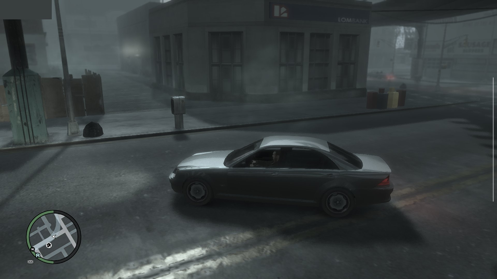

    

# LibertyRecompAndroid - Mali / Infinix Hot 60 Pro+ edition

A fork of [vaduur/LibertyRecompAndroid](https://github.com/vaduur/LibertyRecompAndroid), the Android
port of [Liberty Recompiled](https://github.com/OZORDI/LibertyRecomp) (the static recompilation of
the Xbox 360 version of Grand Theft Auto IV). The game runs natively on arm64 Android phones with
no emulator in between, using Vulkan.

This fork targets phones with an **ARM Mali GPU and a MediaTek SoC**, specifically the
**Infinix Hot 60 Pro+** (Helio G200: 2x Cortex-A76 + 6x Cortex-A55, Mali-G57 MC2). On a device
without an Adreno GPU it:

- uses a lighter first-launch profile (540p, anti-aliasing off, reduced traffic and pedestrians,
  steady 30 FPS target);
- skips the Adreno-only `TU_DEBUG` setting;
- finds the fast CPU cores by `cpu_capacity` and keeps the two busiest threads on them;
- reads the phone's thermal sensors for the thermal guard when there is no Adreno sensor.

See [docs/android/MALI.md](docs/android/MALI.md) for details and tuning steps. Behaviour on Adreno
phones is unchanged.

    

**About this fork.** The original port was made by vaduur, who has put it on hiatus and
encouraged forks. Both the original port and the changes in this fork were written with the help of
Claude (AI), so expect rough edges, and there is no warranty. Upstream issues and releases belong to
vaduur's repository; this fork has no prebuilt APK yet, so build one with
[BUILDING.md](docs/android/BUILDING.md).

> [!CAUTION]
> This is an experimental, unofficial port of a project that is itself in early development.
> Expect crashes and rough edges. Upstream was developed and tested on **one device**, a
> Retroid Pocket 5 (Snapdragon 865 / Adreno 650). The Mali changes in this fork have **not been
> tested on real hardware yet**, including the Infinix Hot 60 Pro+.

**This project does not include any game assets.** You need your own legally obtained copy of the
Xbox 360 game and its title update. Nothing here helps you get them.

## Status

Upstream status, measured on the Retroid Pocket 5 with the default settings (not this fork's Mali profile):

- The game installs, boots and plays: the intro, the early story missions, free roam and driving
  have been played. Saves persist across launches.
- The game renders at the console's native 720p with FXAA. The display scales the image to the panel.
- Frame rate is capped at 30 FPS with VSync. Most places hold a steady 30. The heaviest far views
  (bridges, the skyline at night) drop to about 25–29 FPS.
- Shadows, draw distance and the shadow map size match the console. Traffic and pedestrian density
  are reduced to 40% of the PC defaults to save CPU time.
- Audio works, including the radio, cutscenes and Bink videos.

Known problems:

- Occasional crashes to the home screen still happen. Save often.
- The in-game installer's **Select File / Select Folder** buttons do not work on Android. Install
  from the launcher (0.5.7+) or through the app's `install` folder instead (see
  [INSTALL.md](docs/android/INSTALL.md)).
- One deferred light-volume shader is skipped, because it hangs the GPU under Turnip. A few
  light volumes are missing as a result.
- The episodes (The Lost and Damned, The Ballad of Gay Tony) and online multiplayer have not been
  tested on Android.
- The on-screen gamepad is new (0.5.7.2) and has only been tried on the Retroid Pocket 5 so far
  (see [Controls](#controls)).

## Device requirements

| | Requirement |
|---|---|
| **GPU** | **Qualcomm Adreno 6xx or 7xx** (Snapdragon). Developed and tested on the Adreno 650. **Adreno 8xx: experimental since 0.5.7.5**, see below. **ARM Mali: very early experimental, not supported by the developer, since 0.5.9.3**, tested only on a Pixel 7, see below. |
| **SoC** | Snapdragon 865 class or faster recommended (SD 865/870/888, 8 Gen 1/2/3, 8s Gen 3, …). |
| **CPU** | arm64 with ARMv8.2-A (the build uses LSE atomics). ARMv8.0 chips such as the Snapdragon 835 crash on start. |
| **Android** | Android 10 (API 29) or newer, 64-bit. |
| **RAM** | 8 GB recommended. 6 GB is untested. |
| **Storage** | About 7 GB for the installed game, plus room for the disc image while installing (about 15 GB free in total). |
| **Controller** | An XInput (Xbox-layout) gamepad is strongly recommended, see [Controls](#controls). |

**Not supported:**

- **Samsung Xclipse GPUs** (Exynos 2200 and newer).
- **PowerVR GPUs**, Huawei Maleoon and anything else that is not an Adreno or a Mali.

Why Adreno: the renderer needs Vulkan 1.2 and was tuned on Turnip. Turnip is Mesa's open-source
Vulkan driver, and it exists only for Adreno GPUs. The stock Qualcomm driver on older devices
(including the Adreno 650) exposes only Vulkan 1.1. On other GPUs the bundled driver cannot load,
so the game has to run on the vendor's own driver.

**ARM Mali / Immortalis (most Exynos chips before the 2200, MediaTek Dimensity/Helio, Google
Tensor): very early experimental state, not supported by the developer, since 0.5.9.3.** It has
been tested only on a **Pixel 7** (Mali-G710) with the phone's own (System) driver: the game runs,
but slowly and with audio stutter. Clip planes are skipped (some reflections may show extra
geometry) and DXT textures are decoded on load (more memory, possible stutter while streaming).
Mali support exists thanks to the
[Mali fork](https://github.com/prollynotzjay/LibertyRecompAndroidMaliVer) and the patch in
[#62](https://github.com/vaduur/LibertyRecompAndroid/issues/62). Issues opened for Mali devices
may not be fixed upstream.

**MediaTek Helio G200 / Mali-G57 MC2 (Infinix Hot 60 Pro+): untested, and the weakest class of
device here.** Its GPU and CPU are well below the Snapdragon 865 the port was tuned on, so expect
it to run only at reduced settings, if the phone's driver offers Vulkan 1.2 at all. This fork
adds a lighter profile for it ([MALI.md](docs/android/MALI.md)); `last_launch.txt` shows the Vulkan
version the phone reports.

**Adreno 8xx (Snapdragon 8 Elite and newer): experimental, since 0.5.7.5.** The game has been
started on an Adreno 840 (Samsung, Android 17). The bundled Turnip build does not support Adreno
8xx, so import a Turnip build for it on the launcher (**Import driver (.zip)**), such as the Gen8
Turnip builds made for emulators. This is how it was tested. Expect rough edges, and please report
how it runs in [Issues](https://github.com/vaduur/LibertyRecompAndroid/issues). Low-end Adreno
6xx parts (610/618/619) should start, but expect them to be far too slow.

Since 0.5.6.2, when the bundled Turnip cannot drive the GPU, the app falls back to the device's own
Vulkan driver if that driver offers Vulkan 1.2. It has been tested only on the Mali-G710 above. If no usable driver
exists, the app shows a dialog with the reason instead of closing silently, and it writes
`Android/data/com.libertyrecomp/files/last_launch.txt` with the device, GPU and driver details.
Attach that file when you report a problem.

## Controls

**An XInput (Xbox-layout) gamepad is strongly recommended.** For example:

- an Xbox controller over Bluetooth or USB;
- any XInput-compatible pad;
- the built-in controls of a gaming handheld (Retroid, AYN Odin, AYANEO and similar) in Xbox
  mode.

The game is the Xbox 360 version, so its controls and button prompts follow the Xbox layout one to
one. Other controllers that Android recognizes (DualShock, DualSense, Switch Pro and so on) usually
work through SDL. Their buttons are mapped by position, though, and they have seen much less
testing.

**On-screen gamepad (0.5.7.2 and newer).** Without a controller, the game shows a translucent
Xbox 360 controller on the screen. It disappears as soon as a gamepad is connected, and comes back
when it is disconnected.

- **Left stick:** touch anywhere on the left half of the screen (outside the buttons). The stick
  centres where your thumb lands.
- **Right stick (camera):** touch anywhere on the right half of the screen. It works like a
  controller's right stick.
- **Buttons:** A/B/X/Y lower right, D-pad next to the left stick, LT/LB above the left stick, RT/RB
  on the right, L3/R3 next to the bumpers, Back/Start at the top. Several fingers work at once.
- **Menus** are driven with the same buttons, as on a controller.

Settings in `args.txt` (see [ADVANCED.md](docs/android/ADVANCED.md#other-useful-settings)):

- `--touch_controls=auto|on|off`. `auto` shows the overlay whenever no gamepad is connected, `on`
  always shows it, `off` never does.
- `--gta4_touch_layout=context` brings back upstream's context-sensitive touch layout instead of
  the gamepad.

## Game files required

- The **Xbox 360 GTA IV disc** as an `.iso` image. Only the **USA (NTSC-U)** release has been
  verified.
- **Title Update 8** for that release (version **0.0.8.5**), either as the STFS package or as a raw
  `default.xexp`. The PAL title update (0.0.8.6) is rejected.

The port was developed and tested with these exact files:

| File | Size | MD5 | SHA-1 |
|---|---|---|---|
| `Grand Theft Auto IV (USA) (En,Fr,De,Es,It).iso` (full disc image) | 7,835,492,352 bytes | `f0a046aed1520a913b2125f0a69ee7d0` | `caa48dfb3b1b2fe3131e61fc66e35a22c6d0ba13` |
| `TU_1A581VI_000000K000000.0000000000205` (Title Update 8, STFS package) | 3,715,072 bytes | `f041b5f6721d7ee578560bac21668826` | `88d1c438814298b6da987b3ad5edc7e48a769ac9` |

If your files match, they are known to work. Other dumps of the same USA disc (for example
trimmed or extracted images) may work too, but they have not been tested. Check your files with
`certutil -hashfile <file> MD5` on Windows, or `md5sum <file>` on Linux and macOS.

See the upstream [dumping guide](docs/DUMPING-en.md) for how to get these files from your own
console and disc.

## Quick start

1. Build the APK ([BUILDING.md](docs/android/BUILDING.md); this fork has no prebuilt release yet)
   or install an upstream `LibertyRecompAndroid-*.apk` from vaduur's
   [Releases](https://github.com/vaduur/LibertyRecompAndroid/releases), then open it. The
   app opens on a launcher with the game status, the installer, the Vulkan driver choice and
   **Play** (see [INSTALL.md](docs/android/INSTALL.md#2-open-the-app-the-launcher)).
2. In the **Game** panel (0.5.7 and newer), choose your disc image (`*.iso`) and the Title Update 8
   file wherever they are on the device. The app asks once for *All files access*. On older
   versions, or without that permission, copy both into
   `Android/data/com.libertyrecomp/files/install/` instead (a PC over USB is the easiest way).
   The tested files ([details](#game-files-required)):
   - disc: `Grand Theft Auto IV (USA) (En,Fr,De,Es,It).iso`, MD5 `f0a046aed1520a913b2125f0a69ee7d0`
   - TU8: `TU_1A581VI_000000K000000.0000000000205`, MD5 `f041b5f6721d7ee578560bac21668826`

   The file names do not matter, as long as the disc image ends in `.iso`.
3. Press **Install**, wait for it to finish, then press **Play**.

The full walkthrough, including the `install/` folder and older versions, is in
[INSTALL.md](docs/android/INSTALL.md).

## Documentation

| Document | Contents |
|---|---|
| [Installation and first launch](docs/android/INSTALL.md) | Installing the APK, copying the game files, the first-run installer, upgrading |
| [Mali / MediaTek devices](docs/android/MALI.md) | The Infinix Hot 60 Pro+ profile, what changes on non-Adreno GPUs, and tuning steps |
| [Advanced configuration](docs/android/ADVANCED.md) | `args.txt` settings, live tuning, driver selection, logs, performance presets |
| [What was done for Android](docs/android/PORTING.md) | Technical write-up of the port: build, platform layer, driver, renderer and stability work |
| [Building from source](docs/android/BUILDING.md) | Building the APK yourself |
| [Upstream README](README_UPSTREAM.md) | The original Liberty Recompiled README (desktop builds, mods, online) |

## Credits

- [vaduur/LibertyRecompAndroid](https://github.com/vaduur/LibertyRecompAndroid) by vaduur, the Android
  port this repository is forked from, and the
  [Mali fork](https://github.com/prollynotzjay/LibertyRecompAndroidMaliVer) by prollynotzjay behind
  the first Mali support.
- [Liberty Recompiled](https://github.com/OZORDI/LibertyRecomp) by OZORDI and contributors, and the
  [ReXGlue SDK](https://github.com/rexglue/rexglue-sdk) it is built on. Almost all of the hard work
  of recompiling GTA IV is theirs. This fork adds the Android platform layer and the Android
  performance work.
- [Mesa Turnip](https://docs.mesa3d.org/drivers/freedreno.html), the open-source Adreno Vulkan driver.
  The bundled build is StevenMXZ's Turnip 26.3.0-R6.
- [libadrenotools](https://github.com/bylaws/libadrenotools) by bylaws, which loads a custom driver
  into an app.
- The Vulkan driver proxy comes from [skate3-android](https://github.com/andrewnakas/skate3-android)
  and [skate3-pocket](https://github.com/AlanConstantino/skate3-pocket).
- [SDL3](https://github.com/libsdl-org/SDL) for the Android activity, input and audio.
- [nfsmw-nx](https://github.com/StevensND/nfsmw-nx) by StevensND, a ReXGlue port of Need for Speed:
  Most Wanted to the Nintendo Switch and a great reference for running a ReXGlue recompilation on
  weak hardware. Our direct-calls tool (`gta4-recomp/tools/direct_calls.py`) is adapted from their
  `llamadas_directas.py`. Their work on game busy-waits and thread placement led to this port's
  frame-wait hook and thread pinning experiments.

Grand Theft Auto IV is a trademark of Take-Two Interactive Software. This project is not affiliated
with or endorsed by Rockstar Games or Take-Two Interactive.
